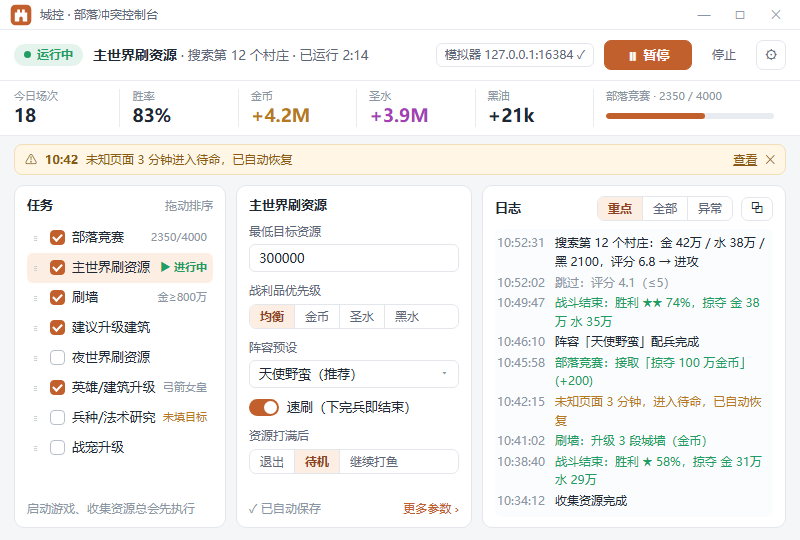
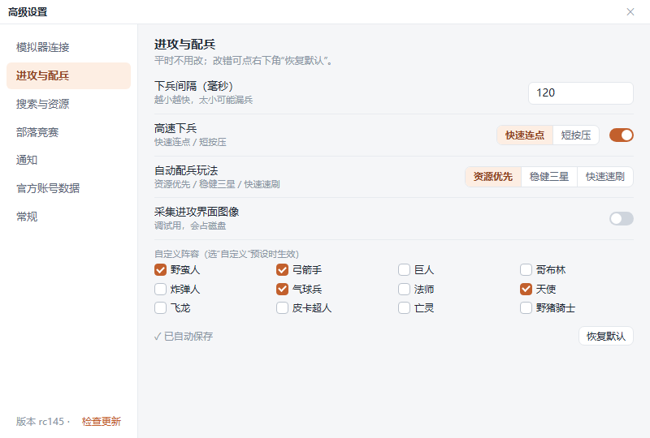
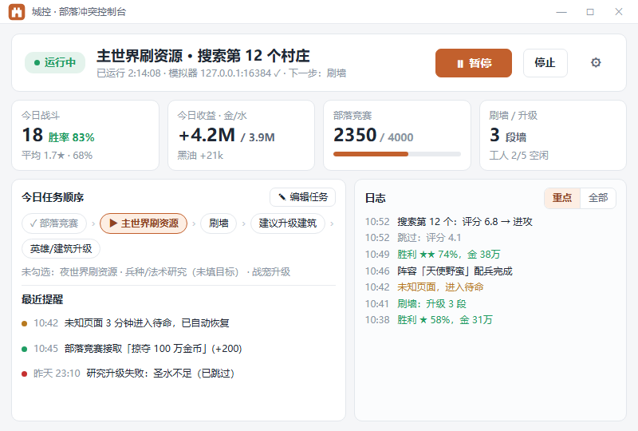
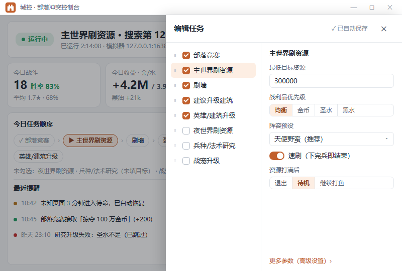
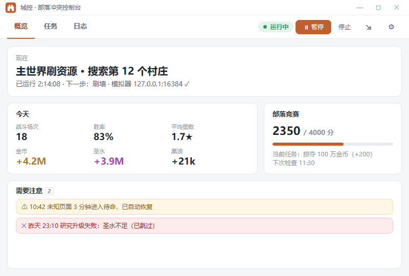
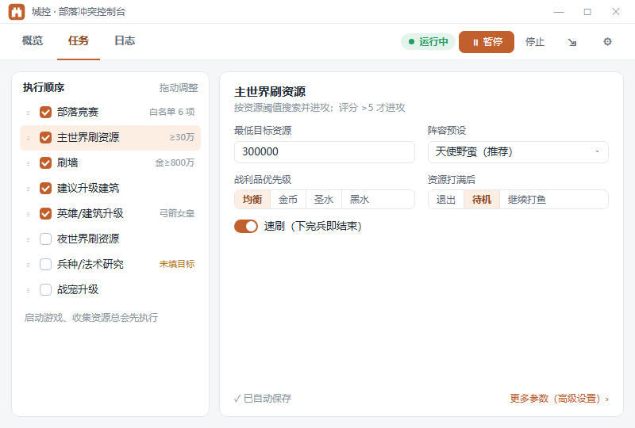
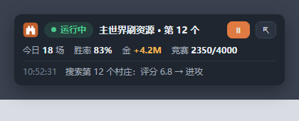
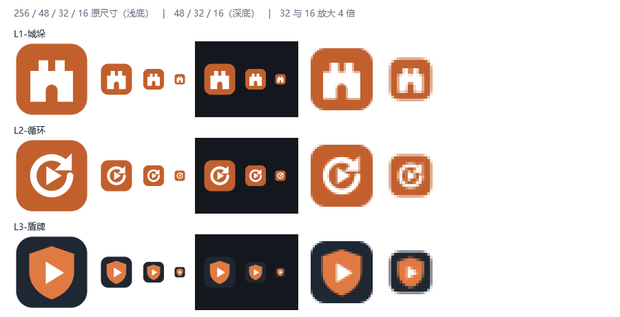

# 城控界面重新设计方案（2026-11-25）

> 只出方案，没有改业务代码、没有提交、没有碰线上 exe 和模拟器。
> 效果图：`docs/界面设计方案/`；HTML 原型源码：`docs/界面设计方案/原型/`；logo：`docs/界面设计方案/logo/`。
> 前提：手机控制、自动启动两页已决定取消（另一个 worker 在删），新设计里不再出现。

**结论先说：推荐方案 A（单屏三栏 + 今日数据条 + 高级设置弹窗），logo 推荐 L1（双塔城楼）。**
理由：主人要看的、要点的都在一屏；结构和现在的 MAA 式「任务列表 + 参数表单」一致，能复用 `任务计划组件` 的大部分代码，工作量最小、回归风险最低；窗口能从现在的最小 1120×680 降到 800×540。

---

## 1. 现状盘点

现状截图是在本工作区用 PySide6 离屏渲染当前源码得到的（假数据、浅色主题）。截图时线上 exe 没在运行，按规定也没有启动它。

| 截图 | 内容 |
|---|---|
| `00-现状-一键运行.png` | 主页，1180×720 |
| `00-现状-一键运行-兵种选择.png` | 主页选中「兵种选择」时 |
| `00-现状-模拟器连接.png` | 连接页 |

### 1.1 窗口结构（`界面/主窗口.py`）

- **侧栏（固定 196px）**：品牌（城控 / 部落冲突控制台）、导航 4 项（一键运行、模拟器连接、手机控制、自动启动）、切换深浅色、检查更新、更新提示链接、版本号。
- **顶栏**：页标题 + 一句说明、状态胶囊、开始/继续、暂停、停止。
- **页面区**：QStackedWidget。
- **其他**：F1/F2 全局热键、悬浮日志窗、窗口最小 1120×680。

### 1.2 一键运行页（`页面_运行.py` + `任务计划组件.py`）

| 区域 | 控件 |
|---|---|
| 任务卡（260~320px） | 8 个任务的勾选列表（可拖拽）、↑ ↓ 全选 清空、提示「拖动或用箭头调整」、**通用设置**列表 7 项（启动游戏、进攻选项、兵种选择、资源打满后的行为、升级完成弹窗确认、通知与状态上报、官方账号数据）、服务器下拉 |
| 设置卡 | 选中项的标题、说明、自动生成的表单、提示条、「修改会自动保存」、**立即保存**按钮、固定步骤说明 |
| 运行状态卡 | 状态胶囊、模拟器描述、当前阶段、最近事件时间 |
| 日志卡 | 跟随、详细、悬浮窗、清空、日志视图 |

参数一共 **35 个**，分在 8 个任务页和 7 个通用页里（`应用/任务计划.py: 任务参数表`）。

### 1.3 模拟器连接页（`页面_设备连接.py`）

包括：一键检测并连接、重启 ADB、检测结果列表、使用所选设备、检测日志、「开始任务时自动检测」勾选；折叠的手动连接（ADB 路径/浏览、地址/连接、设备/扫描、确认是模拟器、保存）；画面预览和测试截图。

「开始任务时自动检测」默认就开着。配置好以后这一页基本不用再打开。

### 1.4 截图里看到的问题

1. **任务列表只显示了 3 行**，8 个任务要滚动才能看全。原因是通用设置列表占了固定高度（7×38px），把任务列表挤扁了。这是最常用的控件，却最难用。
2. **兵种选择表单重叠**：多选框滚动区、下拉框和标签挤成一团，提示条被截断（见 `00-现状-一键运行-兵种选择.png`）。中间设置卡太窄，放不下这类参数。
3. **「⚙」字符在部分字体下显示成方框**（通用设置列表每一项前面）。
4. 窗口最小 1120×680，和模拟器并排放时太占地方。

### 1.5 重复的地方

| 重复项 | 位置 |
|---|---|
| 运行状态 | 顶栏状态胶囊、运行状态卡的状态胶囊、悬浮窗，一共三处 |
| 页标题 | 顶栏大标题 + 说明，和侧栏选中项重复，还占了一整行高度 |
| 调整顺序 | 拖拽和 ↑ ↓ 两套操作 |
| 保存 | 已经自动保存（600ms 防抖），还留着「立即保存」按钮 |
| 设备信息 | 运行页的「模拟器：…」和连接页的「当前：…」 |
| 速刷 / 资源打满 / 升级弹窗 | `生成任务计划()` 把它们当任务行，但界面上它们是通用设置页，概念有两套 |

### 1.6 很少用的东西

**设置一次就不再动的**：服务器（国际服/调试服务器）、启动游戏开关、升级弹窗确认、企业微信 Webhook 和上报间隔、官方 API Token / 玩家标签 / 同步间隔、手动 ADB 连接、测试截图、重启 ADB。

**调试和调优用的**：YOLO 熔断次数、资源边缘比例、漏兵复核兵种数、最大搜索次数、最长搜索时长、黑水仓容量、下兵间隔、高速下兵及方式、采集进攻图像、自定义兵种/法术/攻城。

**日志区**：清空、跟随（应该改成滚到底部时自动跟随）。

**侧栏**：检查更新、切换主题。删掉手机控制和自动启动以后，导航只剩 2 项，196px 的侧栏就不值得了。

---

## 2. 参考：MAA 和同类挂机工具

- **MAA（MaaAssistantArknights，WPF）**：「一键长草」页左侧是任务勾选列表，可拖拽排序，每项带齿轮；中间是选中任务的少量常用参数；右侧是日志；底部是一个「Link Start!」大按钮。连接、高级战斗参数、通知、更新都放在单独的「设置」页，按左侧分类导航。日常只需要一个页面。
- **同类挂机工具的共同做法**：
  - 主界面只回答「在不在跑、在干什么、跑得怎么样」，配一个开始/暂停按钮。
  - 参数分成「常用」和「高级」两层，高级参数带「恢复默认」。
  - 有可置顶的迷你状态条，边玩边看。
  - 异常集中成提醒列表，而不是混在日志里。
- **本项目已经有的基础**：
  - MAA 式任务列表 + 自动生成的表单（`任务参数表` + `_创建编辑器`）。
  - 日志重点/全部两档，`日志视图._空提示` 里已经有「异常」模式。
  - `聚合器.当前阶段()` 能给出当前在做什么。
  - 悬浮日志窗、F1/F2 热键。

  缺的是：信息分层、「今日数据」，以及把高级参数挪出主界面。

---

## 3. 主人日常需要什么，数据从哪来

| 需求 | 现在有没有 | 数据来源 / 缺口 |
|---|---|---|
| 是否在运行 | 有 | `控制器.状态` |
| 当前在做什么 | 有 | `聚合器.当前阶段()`、`快照.最近日志`；「已运行时长」「下一步」需要控制器记录开始时间，并按任务顺序推算 |
| 今日场次 / 胜率 | **只有累计值** | 状态键「战斗胜率」里有完成场次、胜场、胜率、平均星数，但都是累计值。要在同一次 `更新状态` 里多写一个按日期分桶的 `按日[YYYY-MM-DD]`，改动在 `等待战斗结束并回营.py` 里，约 20 行 |
| 资源收益 | **没有** | 「家乡资源」只有当前存量。可选做法：① 每天第一次读数作基线，算存量差（但刷墙、升级的花费会抵消）；② 累加每场的战利品识别结果（现在只记了「最近战利品目标」，是进攻前看到的可掠夺量，不是实际收入）。建议第一版标注「估算」，用 ② 的目标值累加 |
| 部落竞赛进度 | **只写在日志里** | `部落竞赛.py` 已经 OCR 出个人积分（日志「个人积分 x/y」），但没有存下来。要写进「部落竞赛检查记录」，再加当前任务和下次检查时间，约 10 行 |
| 最近异常 / 待命提醒 | 部分有 | 日志级别 警告/错误、「安全待命」日志、升级失败记录（建筑/研究/战宠失败记录状态键）。在聚合器里加「最近 N 条提醒」，规则是 级别 ≥ 警告，或包含 待命/失败 |
| 开始 / 暂停 | 有 | 按钮 + F1/F2 |
| 勾选任务和顺序 | 有 | `任务计划组件` |
| 少数常调参数 | 有，但混在 35 个参数里 | 给 `参数字段` 加一个 `常用: bool` 标记，主界面只渲染常用的 |

**常用参数**（建议放主界面）和**高级参数**（放进高级设置）的划分如下。所有方案都用这一套：

| 任务 / 分组 | 主界面（常用） | 高级设置 |
|---|---|---|
| 主世界刷资源 | 最低目标资源、战利品优先级、阵容预设、速刷开关、资源打满后 | 黑水仓容量、资源边缘比例、漏兵复核兵种数、最大搜索次数、最长搜索时长、YOLO 熔断次数 |
| 夜世界刷资源 | 最低目标资源、战利品优先级 | 黑水仓容量、资源边缘比例、漏兵复核 |
| 部落竞赛 | 只接这些任务（白名单）、检查间隔 | 个人积分上限 |
| 刷墙 | 起始金币、起始圣水 | — |
| 英雄/建筑、战宠、研究 | 升级目标 | — |
| 进攻选项 | （速刷挪到主世界刷资源里） | 下兵间隔、高速下兵及方式、自动配兵开关与玩法、采集进攻图像 |
| 兵种选择 | （阵容预设挪到主世界刷资源里） | 自定义兵种、法术、攻城 |
| 常规 | — | 启动游戏开关、升级弹窗确认、服务器、深浅色、检查更新/版本 |
| 连接 | 顶栏显示设备和连接状态 | 一键检测、重启 ADB、手动连接、测试截图（整个原连接页） |
| 通知 / 官方数据 | — | 企业微信 Webhook、上报间隔、待命通知阈值；API Token、玩家标签、同步间隔 |

主界面一共 **14 个常用参数**，选中某个任务时最多显示 5 个。其余 21 个放进高级设置。

---

## 4. 三个方案

效果图都是 800×540（含标题栏），浅色主题，数据是虚构的示意数据。

### 方案 A：单屏三栏（MAA 式）+ 今日数据条（推荐）



**布局，从上到下：**

1. **状态栏**：状态胶囊、当前任务 · 当前动作 · 已运行时长、模拟器芯片（点一下打开高级设置的连接页）、开始/暂停合成一个主按钮（F1/F2 不变）、停止（弱化）、⚙ 高级设置。
2. **今日数据条**：今日场次、胜率、金币、圣水、黑油、部落竞赛进度条。
3. **提醒条**：只在有未读提醒时出现，显示最新一条，带「查看」（日志切到异常）和「✕」。
4. **三栏**：
   - 左栏「任务」（约 210px）：勾选 + 拖拽，每行右侧有一个摘要（目标值、未填目标、进行中）。
   - 中栏：选中任务的常用参数，最多 5 个，底部有「更多参数 ›」。
   - 右栏「日志」：重点 / 全部 / 异常三档，⧉ 打开置顶小窗。

**去掉的东西**：侧栏、页标题和说明、运行状态卡、通用设置列表、服务器下拉、↑↓/全选/清空（全选/清空挪到右键菜单）、立即保存、跟随/清空（改成自动跟随，清空挪到右键）。

**高级设置**（⚙ 打开，模态窗口，见下图 `高级设置.png`）：左侧导航包括 模拟器连接 / 进攻与配兵 / 搜索与资源 / 部落竞赛 / 通知 / 官方账号数据 / 常规。表单继续用现有的自动生成器，每页带「恢复默认」。



**工作量**：约 3.5~4.5 人日

| 项目 | 人日 |
|---|---|
| 主窗口重排（去侧栏、新状态栏、数据条、提醒条） | 1 |
| `参数字段` 加「常用」标记，表单只渲染常用字段，「更多参数」跳转到高级设置对应页 | 0.5 |
| 高级设置窗口（复用表单生成器，嵌入现有 `设备连接页`） | 1 |
| 今日统计数据：按日胜率分桶、部落竞赛积分落库、提醒聚合、开始时间 | 1~1.5 |
| 测试：`tests/test_qt_ui.py` 等 | 0.5 |

**风险**：

- 800px 宽度下，三栏中间栏只有约 236px。现在只放常用参数，没问题；兵种多选这类宽控件已经挪到高级设置。如果以后有人往常用里加宽控件，会再次挤坏。对策：常用字段只允许 int / choice / bool / 短 list 这几种类型。
- 今日收益第一版是估算，要在界面上标明，避免主人误以为是精确值。
- 和另一个 worker 正在删的手机控制/自动启动代码有冲突，要等那边合并后再动 `主窗口.py`。

---

### 方案 B：仪表盘 + 任务抽屉




**布局**：

- **大状态卡**：状态、当前动作、已运行、下一步、暂停/停止大按钮、⚙。
- **4 张数据卡**：今日战斗 + 胜率、今日收益、部落竞赛进度、刷墙/升级。
- **下半部分两栏**：
  - 左栏：「今日任务顺序」流程胶囊（已完成 ✓ / 进行中 ▶ / 待执行），加上「最近提醒」列表（3 条）。
  - 右栏：精简日志。
- **编辑任务**：点「✎ 编辑任务」从右侧滑出抽屉，里面是任务列表加常用参数，结构和方案 A 的左栏、中栏一样。
- 高级设置和方案 A 共用。

**优点**：看状态最直观，「今天跑到哪一步」一目了然，提醒是独立区块不会被日志冲掉。
**缺点**：改任务要多点一下（打开抽屉），而勾选任务和调参数恰恰是主人的常用操作之一。日志区域比 A 小。

**工作量**：约 5~6 人日

| 项目 | 人日 |
|---|---|
| 仪表盘卡片 + 流程胶囊（要算当前和下一个任务、已完成标记，需要在 `自动化机器人` 的任务循环里暴露当前任务键） | 2 |
| 抽屉动画与遮罩 | 0.5~1 |
| 其余和 A 相同 | 2.5 |

**风险**：

- 流程胶囊依赖任务循环暴露状态。这块正是另一个 worker 在改的稳定性代码，容易冲突。
- 仪表盘信息多，数据缺失时（比如刚启动、或今天还没打）要设计好空状态，否则一片「—」。

---

### 方案 C：三页签 + 迷你条





**布局**：

- **顶部页签**：概览 / 任务 / 日志。右侧常驻状态胶囊、暂停、停止、⇲（迷你条）、⚙。
  - **概览**：现在在做什么（大字）、今天（6 个数字）、部落竞赛卡、需要注意（提醒列表）。
  - **任务**：左边列表、右边两列参数网格。参数区比 A 宽，能放下更多常用参数。
  - **日志**：整页日志，带筛选。
- **迷你条**（约 380×110，置顶、半透明）：状态、当前动作、暂停、关键数字、最新一条日志。用来替代现在的悬浮日志窗，挂机时主窗口可以最小化。

**优点**：每页都很干净，窗口可以更小。迷你条最适合「边玩边挂」。
**缺点**：看状态和改任务分在两个页签，来回切换。日志不在首页，排查问题多一步。

**工作量**：约 4~5 人日。页签和概览页 1.5，迷你条替换悬浮窗 1，其余和 A 相同 2~2.5。

**风险**：

- 迷你条要处理置顶、多屏位置记忆、和主窗口互相唤醒；现有 `悬浮日志窗` 的这部分逻辑可以复用。
- 页签切换后定时刷新只刷当前页（现在的机制），概览页上的数据会有 1 秒延迟。可以接受。

---

### 对比和推荐

| | A 单屏三栏 | B 仪表盘 + 抽屉 | C 页签 + 迷你条 |
|---|---|---|---|
| 一眼看全状态 | ★★★（数据条） | ★★★★ | ★★★（在概览页） |
| 勾任务、调参数 | ★★★★（就在首页） | ★★（要开抽屉） | ★★★（要切页签） |
| 日志可见性 | ★★★★ | ★★ | ★★（在单独页签） |
| 复用现有代码 | 高 | 中 | 中高 |
| 工作量 | 3.5~4.5 人日 | 5~6 人日 | 4~5 人日 |
| 和并行开发冲突 | 低 | 中（要动任务循环） | 低 |

**推荐 A**，理由：

1. 主人列的需求「看状态 + 勾任务排序 + 调少数参数」三件事在 A 里都不用切换页面。
2. A 和现在的 MAA 式结构一脉相承，主人不用重新学，代码也是在原组件上做减法和挪位置。
3. 工作量最小，不需要动任务循环，不会和正在进行的稳定性修复冲突。

**可选增强**：做完 A 之后，可以把 C 的「迷你条」作为悬浮日志窗的升级版单独加上（约 1 人日）。它和 A 不冲突。

---

## 5. Logo 方案

### 5.1 现在用的图标

- **exe 图标**：`界面/城控.ico`，由 `界面/生成应用图标.py` 用 Pillow 画出来，包含 16/24/32/48/64/128/256 七个尺寸。`自动脚本.spec` 第 101 行 `icon=` 引用它，第 54 行把它作为数据文件打进包里。
  - 图形：浅杏色圆角底（#fff0e1），上面是一个橙色（#c86c39）四齿城垛塔，中间是白色方门，底下有一条深棕地平线。
  - 预览：`logo/00-现有图标-256.png`。
- **窗口和界面左上角**：`界面/组件.py` 的 `品牌标志` / `绘制标志` / `应用图标()` 用 QPainter 再画一遍类似的城垛，颜色是 #fdeee3、#c2602d、#8f4321。
  - 问题：和 ico 的颜色和坐标都不完全一样，**同一个图标有两份实现**。
  - 问题：浅杏底在浅色任务栏和浅色界面上对比度低，16px 下城垛齿和门糊在一起。

### 5.2 三个新方案

全部是原创几何图形，没有文字，没有使用或模仿 Supercell 和部落冲突的 logo、角色、字体、美术素材。配色直接取界面令牌：强调色 #c2602d，深色模式强调色 #e07a43，文字色 #1f2733。

| 方案 | 图形 | 文件 |
|---|---|---|
| **L1 双塔城楼（推荐）** | 品牌橙实心圆角方底，上面一个白色双塔城楼剪影，带拱门。延续「城控」的城楼意象，但改成**深底白图**，对比度高；形状只有一条外轮廓，16px 也能认出来 | `logo/L1-城垛.svg` · `L1-城垛-{256,48,32,16}.png` · `L1-城垛.ico` |
| L2 自动循环 | 品牌橙底，白色循环箭头环绕播放三角，表达「自动挂机」。32px 以上很好看，16px 下箭头会糊，所以附了一个 16px 手调版（去掉箭头，只留环和三角），见 `L2-16px-手调对比.png` | `logo/L2-循环.svg` · `L2-循环-16.svg`（手调） · PNG · `.ico` |
| L3 盾牌播放 | 深色（#1f2733）底，橙色盾牌，里面一个白色播放三角。在浅色任务栏上最醒目；缺点是在深色任务栏上底色融进背景，要靠橙色盾牌识别 | `logo/L3-盾牌.svg` · PNG · `.ico` |

所有方案的尺寸对比（原尺寸、深浅底、32/16 放大 4 倍）：



**推荐 L1**，理由：

1. 和「城控」这个名字直接对应，老用户认得。
2. 16px 下轮廓最清楚。
3. 实心品牌橙底和界面主按钮是同一个颜色，深浅主题下都成立。

原型效果图标题栏左上角用的就是 L1。

### 5.3 三处怎么用

| 用途 | 做法 |
|---|---|
| exe 图标 | 打包前用下面的脚本生成 `界面/城控.ico`，spec 不用改 |
| 窗口图标 / 任务栏 | `QIcon(":/城控.ico")` 或直接 `QIcon(<ico 路径>)`，替换掉 `应用图标()` 里的 QPainter 绘制 |
| 界面左上角 | 用 `QSvgRenderer` 渲染 SVG，或者用 ico 里的 32/48 尺寸。`品牌标志` 改成加载同一份资源 |

这样三处只有一份源文件（SVG），不会再出现两份实现对不上的问题。

### 5.4 生成 .ico 的方法

脚本是 `logo/生成图标.py`，方案附带，没有接入构建：

```
python docs/界面设计方案/logo/生成图标.py docs/界面设计方案/logo/L1-城垛.svg 界面/城控.ico
```

- 用 PySide6 的 `QSvgRenderer` 把 SVG **分别渲染**成 16/20/24/32/40/48/64/128/256 九个尺寸，而不是从 256 缩小，所以小尺寸更清楚。
- 用 Pillow（≥10.1，`append_images`）打包成一个多尺寸 .ico。
- 如果同目录有 `<名>-16.svg` 这类手调小尺寸文件，会优先用它（L2 就是这么用的）。
- 已经用这个脚本生成了三个方案的 `.ico`（`logo/L*.ico`）并验证过，包含 9 个尺寸。
- 落地时可以把它替换进 `界面/生成应用图标.py`。打包环境里已经有 PySide6 和 Pillow，不需要新增依赖。

---

## 6. 落地顺序建议（如果主人选 A）

1. 等手机控制/自动启动删除合并以后再开工，避免和 `主窗口.py` 冲突。
2. **后端数据（可以独立先做）**：
   - 「战斗胜率」加按日分桶。
   - 部落竞赛把个人积分、当前任务、下次检查时间写进状态。
   - 控制器记录开始时间。
   - 聚合器加「最近提醒」。
3. `参数字段` 加 `常用` 标记，按第 3 节的表划分。
4. 新的高级设置窗口：把连接页整体搬进去，通用设置的 7 页按新分类重组。
5. 主窗口改成单屏：状态栏、数据条、提醒条、三栏。最小尺寸 800×540。
6. 换 logo：统一成一份 SVG 源，生成 ico，`品牌标志` 改为加载同一份资源。
7. 回归：`tests/test_qt_ui.py`、`test_ui_version_display.py`，再加三项手测：深色主题、125%/150% DPI、F1/F2。

## 附：文件清单

```
docs/界面设计方案-2026-11-25.md          本报告
docs/界面设计方案/
  00-现状-一键运行.png / 00-现状-一键运行-兵种选择.png / 00-现状-模拟器连接.png
  A-主界面.png  高级设置.png            方案 A（推荐）
  B-仪表盘.png  B-任务抽屉.png          方案 B
  C-概览.png    C-任务.png  C-迷你条.png  方案 C
  原型/*.html + base.css               以上效果图的 HTML 源（Edge 无头模式截图）
  logo/L1-城垛.* L2-循环.* L3-盾牌.*    SVG 源、256/48/32/16 PNG、.ico
  logo/logo-对比.png  L2-16px-手调对比.png  00-现有图标-256.png
  logo/生成图标.py                     SVG → 多尺寸 .ico
```
